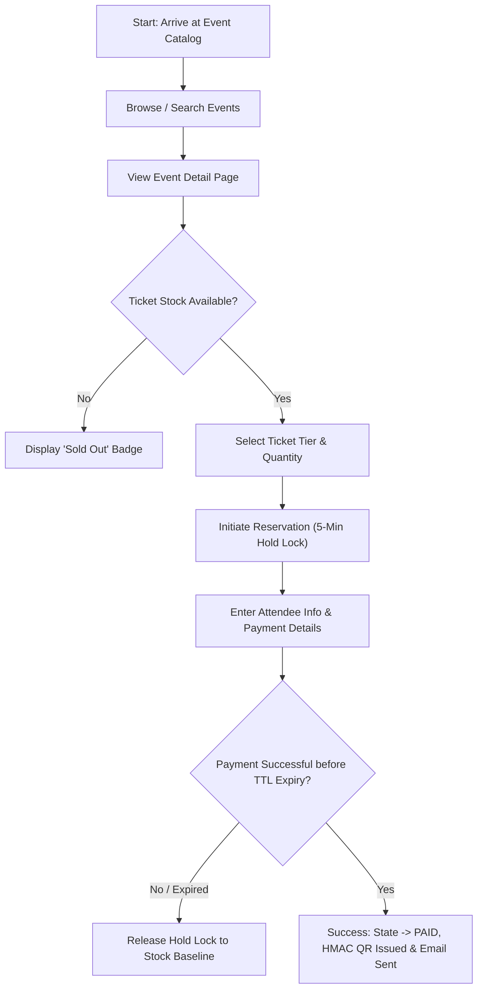
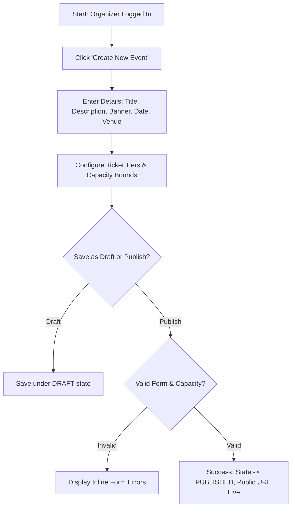
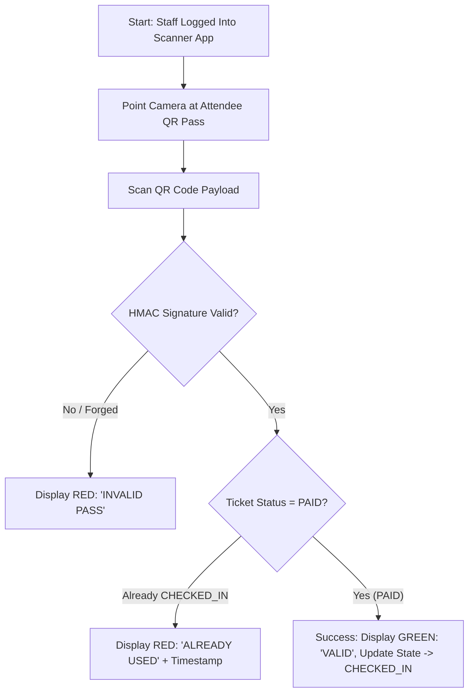
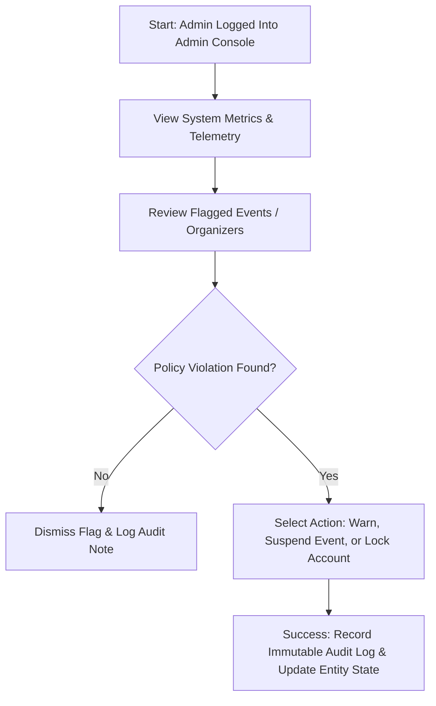

# EVENTRA — Initial High-Level User Journeys

---

## 1. Customer Journey: Discovering & Purchasing an Event Ticket

### Journey Attributes
- **Start State**: Unauthenticated or Authenticated Attendee arrives at EVENTRA homepage or public event direct link.
- **Steps**:
  1. Browse or filter public event catalog by category, keyword, or date.
  2. Select event card to view full detail page (venue, date, speakers, ticket tiers).
  3. Select desired ticket tier (e.g. General Admission) and quantity.
  4. Click "Reserve Tickets" $\rightarrow$ System triggers a 5-minute atomic hold lock.
  5. Complete checkout form (name, email, card details).
  6. Submit payment $\rightarrow$ View order confirmation page with embedded HMAC digital QR pass.
- **Key Decisions**:
  - Is ticket stock $>0$?
  - Is payment completed before the 5-minute hold timer expires?
- **Success State**: Booking state transitions to `PAID`, digital HMAC QR pass rendered on screen, confirmation email dispatched.
- **Failure / Alternative Paths**:
  - *Timer Expiry*: User takes $>5$ minutes $\rightarrow$ Reservation expires; ticket released back to inventory pool; user notified to retry.
  - *Payment Failure*: Card declined $\rightarrow$ User shown error message; hold timer continues ticking; user can re-enter card details.
- **Important System Interactions**:
  - Atomic inventory decrement / Redis TTL reservation hold.
  - Payment gateway tokenization and webhook callback processing.
  - HMAC-SHA256 signature generation and asynchronous email queue dispatch.

---

## 2. Event Organizer Journey: Creating & Publishing an Event

### Journey Attributes
- **Start State**: Authenticated Organizer on Organizer Dashboard.
- **Steps**:
  1. Click "Create New Event" button.
  2. Input event metadata (Title, Category, Description, Date/Time, Venue Location, Banner Image).
  3. Add ticket tiers (e.g. Early Bird, VIP) specifying price and capacity limits.
  4. Preview public event landing page view.
  5. Click "Publish Event".
- **Key Decisions**:
  - Save as `DRAFT` for later editing vs Publish `LIVE` immediately?
  - Are all capacity bounds valid ($>0$ tickets)?
- **Success State**: Event transitions to `PUBLISHED` state, public URL generated, event indexed in catalog search.
- **Failure / Alternative Paths**:
  - *Validation Failure*: Form submitted with past date or zero capacity $\rightarrow$ Inline error fields highlighted; publication blocked.
- **Important System Interactions**:
  - Multi-part form payload handling & image asset storage.
  - DB transaction inserting Event entity and linked TicketTier inventory records.
  - Public catalog cache invalidation / search index update.

---

## 3. Event Staff Journey: Validating a Ticket at Gate Entry

### Journey Attributes
- **Start State**: Authenticated Gate Inspector on Mobile Scanner Web App.
- **Steps**:
  1. Open scanner camera view on mobile device.
  2. Point camera at attendee's presented digital QR pass (screen or printout).
  3. System parses QR payload, verifies HMAC signature, and checks ticket status.
  4. Full-screen visual and audio feedback displayed (Green beep vs Red buzz).
  5. Staff admits attendee or directs to resolution desk.
- **Key Decisions**:
  - Is the HMAC cryptographic signature authentic?
  - Is the ticket status `PAID` (not `CHECKED_IN` or `CANCELLED`)?
- **Success State**: Ticket state atomically mutated from `PAID` $\rightarrow$ `CHECKED_IN`, entry timestamp and gate ID logged, green "VALID" screen displayed.
- **Failure / Alternative Paths**:
  - *Duplicate Scan*: Ticket was already scanned $\rightarrow$ Red "ALREADY USED" screen displayed showing original entry timestamp.
  - *Tampered QR*: Payload modified $\rightarrow$ Red "INVALID PASS" screen displayed.
- **Important System Interactions**:
  - Cryptographic HMAC-SHA256 signature verification.
  - Atomic state transition in database/cache (`PAID` $\rightarrow$ `CHECKED_IN`).
  - Audit log event write for gate entry.

---

## 4. Platform Administrator Journey: Managing Platform & Moderation

### Journey Attributes
- **Start State**: Authenticated Super-Admin on Admin Console.
- **Steps**:
  1. Review system telemetry dashboard (active users, throughput, error rates).
  2. Access moderation queue to inspect reported event listings or flagged accounts.
  3. Review event listing details, organizer history, and attendee complaints.
  4. Select administrative action (Dismiss, Flag, Suspend Event, Lock Account).
  5. Input mandatory administrative justification notes and submit.
- **Key Decisions**:
  - Does the event listing violate platform safety or fraud policies?
  - Should the event be suspended or granted a compliance warning?
- **Success State**: Administrative action executed immediately, entity state updated (`SUSPENDED`), immutable audit log entry written.
- **Failure / Alternative Paths**:
  - *False Alarm*: Flag reviewed and found compliant $\rightarrow$ Flag dismissed with audit note; event remains live.
- **Important System Interactions**:
  - RBAC verification enforcing `ROLE_SUPER_ADMIN`.
  - Global query filters retrieving metric telemetry.
  - Immutable audit trail append-only write.

---

## 5. Definition of Done (DoD) — Sub-Phase 1.8
- [x] All 4 high-level user journeys mapped out (Customer, Organizer, Gate Staff, Administrator).
- [x] Start state, steps, key decisions, success states, failure paths, and system interactions documented for each journey.
- [x] Visual sequence flowcharts included for clarity.
- [x] Documented and saved to [`docs/08_USER_JOURNEYS.md`](file:///Users/firozansari/Downloads/Coading/Intership/docs/08_USER_JOURNEYS.md).
