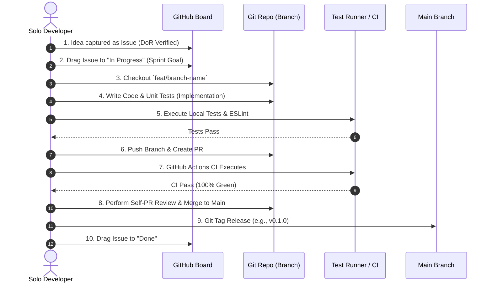

# EVENTRA — Solo-Developer Agile Development Methodology

---

## 1. Solo-Developer Micro-Sprint Framework

> [!NOTE] 1-Week Iterative Micro-Sprints
> EVENTRA uses **1-week Micro-Sprints** (7-day cycles) to maintain momentum, provide clear focus, and prevent scope drift.

```
Monday Morning          Mon - Fri               Friday Afternoon
┌─────────────────┐     ┌─────────────────┐     ┌───────────────────────┐
│ Sprint Planning │ ──> │ Feature Coding, │ ──> │ Self-PR Review,       │
│ & Goal Setting  │     │ Testing & Docs  │     │ Merge to Main & Retro │
└─────────────────┘     └─────────────────┘     └───────────────────────┘
```

---

## 2. Methodology Components

### A. Sprint Planning & Sprint Goal
- **Duration**: 30 minutes at start of sprint (every Monday).
- **Process**: Select 2–4 issues from the backlog that align with a single **Sprint Goal** (e.g. *"Complete Task 1 Public Landing Page CSS Grid Layout"*).

### B. Backlog & Prioritization
- **Backlog Management**: Single GitHub Project Board.
- **Priority Rules**: Items ordered strictly by `p0-blocker` $\rightarrow$ `p1-high` $\rightarrow$ `p2-medium`. Items must meet the Definition of Ready (DoR).

### C. Implementation & Coding Standard
- Work executed on short-lived feature branches (`feat/...`, `fix/...`).
- Strict adherence to domain module boundaries (Catalog, Booking, Auth, Payment).

### D. Testing Strategy
- **Unit Tests**: Test core domain logic in isolation (e.g. reservation hold expiration math).
- **Integration Tests**: Test API endpoints with database fixtures (Supertest + PostgreSQL).
- **UI Tests**: Test layout responsiveness across mobile ($320\text{px}$), tablet ($768\text{px}$), and desktop ($1200\text{px}$).

### E. Self-PR Review & Verification
- Review code diff on GitHub before merging to ensure clean formatting, zero commented-out code, and clear commit messages.
- Automated CI pipeline must pass 100% of tests and ESLint checks.

### F. Retrospective (Weekly Reflection)
- **Duration**: 15 minutes at end of sprint (every Friday).
- **3-Point Audit**:
  1. What went smoothly?
  2. What caused friction or context switching?
  3. What process or architectural decision needs simplification next sprint?

### G. Release Process
- Merge approved PR into `main`.
- Create annotated Git tag (`git tag -a v0.1.0 -m "Release v0.1.0 - Task 1 Landing Page"`).
- Push tag to repository (`git push origin v0.1.0`).

### H. Bug Workflow
1. File Bug Issue with reproduction steps and stack trace.
2. Create `fix/...` branch.
3. Write a failing automated test reproducing the bug.
4. Apply fix code until the test passes.
5. Merge fix PR into `main`.

### I. Technical Debt Workflow
- Label refactoring tasks as `type: refactor`.
- Allocate **20% of every sprint** (1 full day per week) to paying down technical debt and refactoring.

### J. Security & Privacy Work
- Security checks built into standard definition of done.
- Run `npm audit` and Snyk security scans before every release tag.

### K. Documentation Work (Docs-as-Code)
- Documentation updated in the **same branch and commit** as the feature code.
- No code pull request is approved without corresponding documentation updates.

---

## 3. Complete Feature Lifecycle (Idea $\rightarrow$ Release)



---

## 4. Definition of Done (DoD) — Sub-Phase 1.14
- [x] 1-Week Micro-Sprint workflow defined.
- [x] All 13 methodology components documented.
- [x] End-to-end feature lifecycle (Idea $\rightarrow$ Issue $\rightarrow$ Implementation $\rightarrow$ Test $\rightarrow$ Review $\rightarrow$ Release) mapped with sequence diagram.
- [x] Saved to [`docs/14_DEVELOPMENT_METHODOLOGY.md`](file:///Users/firozansari/Downloads/Coading/Intership/docs/14_DEVELOPMENT_METHODOLOGY.md).
