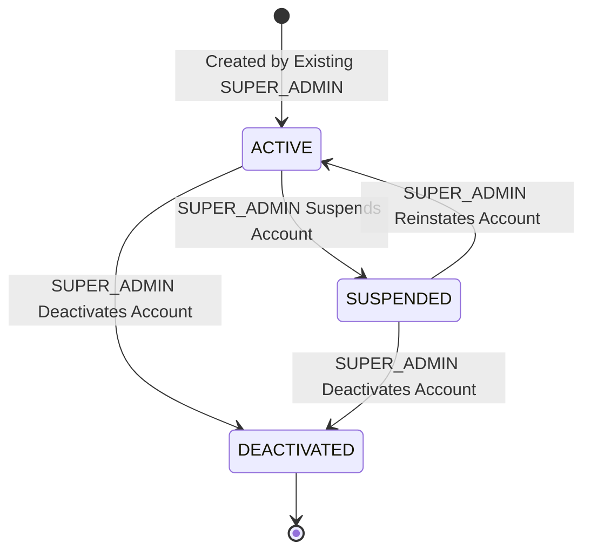
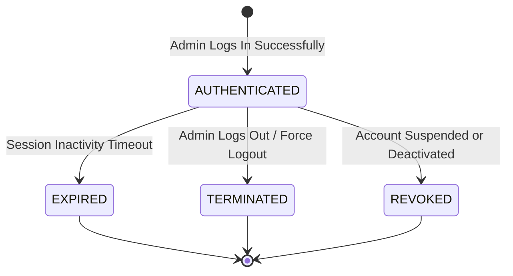
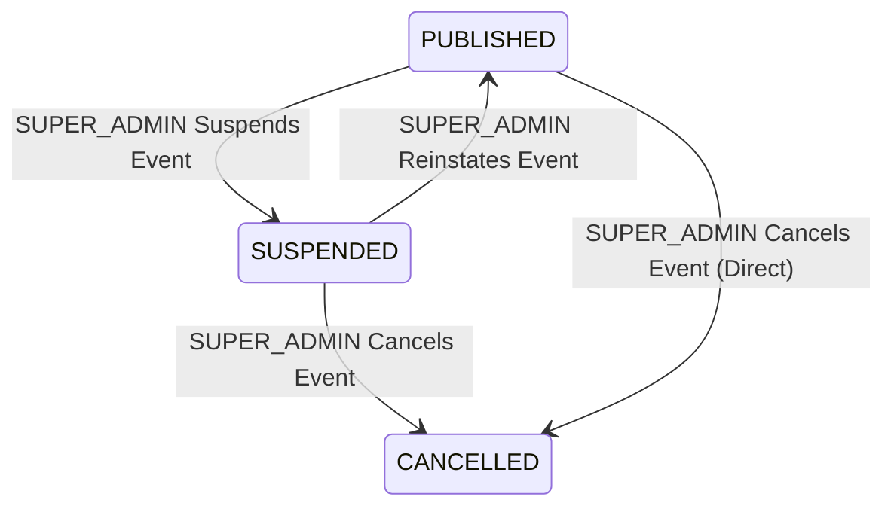
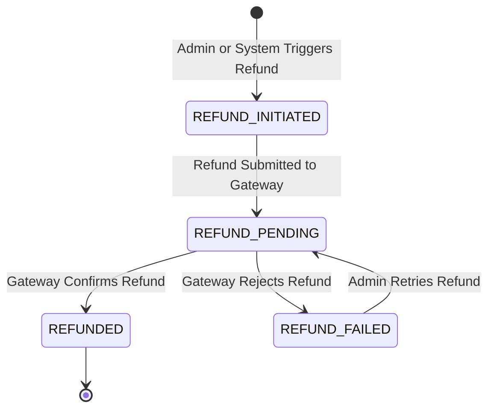
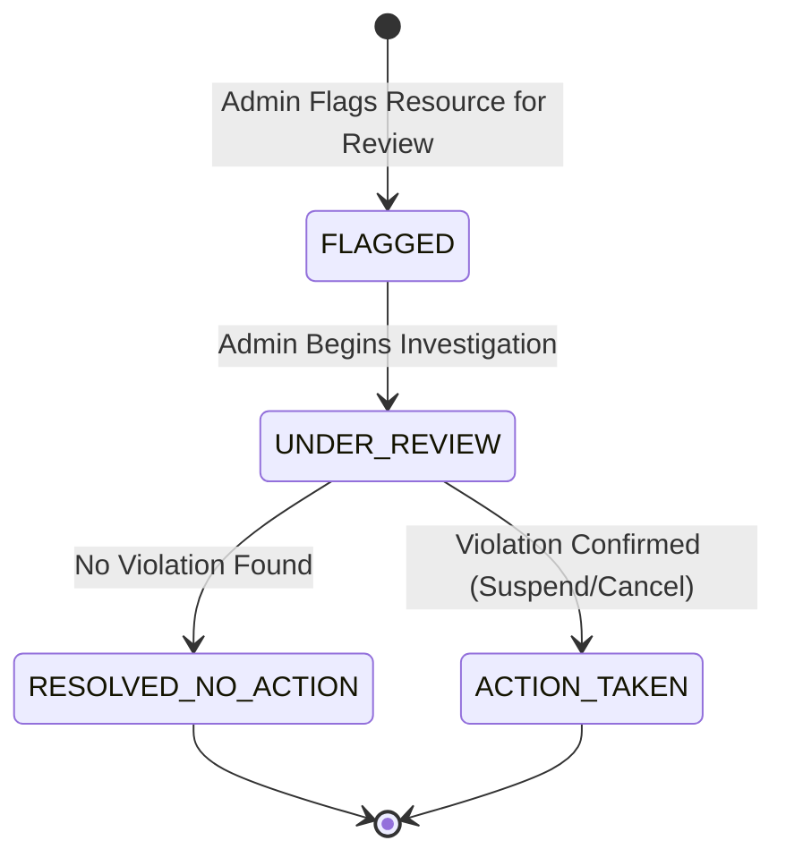

# EVENTRA — Admin Lifecycle & State Specifications

---

## 1. Overview & Purpose

This document defines the lifecycle state models relevant to administrative operations in EVENTRA. Each domain entity lifecycle is documented independently with states, allowed transitions, forbidden transitions, and triggers from the admin perspective. These are consistent with and extend the existing lifecycle specifications in `lifecycle-rules.md` and `organizer-lifecycle.md`.

---

## 2. Admin Account Lifecycle

### 2.1 State Diagram

### 2.2 State Table

| State             | Meaning                                                                                     | Allowed Transitions        | Forbidden Transitions | Trigger                                                                                             |
| :---------------- | :------------------------------------------------------------------------------------------ | :------------------------- | :-------------------- | :-------------------------------------------------------------------------------------------------- |
| **`ACTIVE`**      | Admin account is operational and can perform role-assigned actions.                         | `SUSPENDED`, `DEACTIVATED` | —                     | Created by existing SUPER_ADMIN (ADMIN-001).                                                        |
| **`SUSPENDED`**   | Admin account temporarily disabled pending investigation. Cannot perform any admin actions. | `ACTIVE`, `DEACTIVATED`    | Direct re-creation.   | SUPER_ADMIN suspends account.                                                                       |
| **`DEACTIVATED`** | Admin account permanently disabled. Terminal state.                                         | None (Terminal)            | `ACTIVE`, `SUSPENDED` | SUPER_ADMIN deactivates account. Constraint: cannot deactivate last active SUPER_ADMIN (ADMIN-005). |

---

## 3. Admin Session Lifecycle

### 3.1 State Diagram

### 3.2 State Table

| State               | Meaning                                                                           | Allowed Transitions                | Trigger                                                                                                            |
| :------------------ | :-------------------------------------------------------------------------------- | :--------------------------------- | :----------------------------------------------------------------------------------------------------------------- |
| **`AUTHENTICATED`** | Admin has a valid active session.                                                 | `EXPIRED`, `TERMINATED`, `REVOKED` | Successful admin login with valid credentials.                                                                     |
| **`EXPIRED`**       | Session timed out due to inactivity. Terminal.                                    | None                               | Inactivity timeout reached.                                                                                        |
| **`TERMINATED`**    | Admin voluntarily logged out or forced logout by another admin. Terminal.         | None                               | Admin clicks logout; or SUPER_ADMIN forces session termination.                                                    |
| **`REVOKED`**       | Session invalidated because admin account was suspended or deactivated. Terminal. | None                               | Admin account status changes to `SUSPENDED` or `DEACTIVATED`. All active sessions must be immediately invalidated. |

---

## 4. Organizer Account Lifecycle (Admin Perspective)

This extends `organizer-lifecycle.md` Section 2 from the admin's operational view.

### 4.1 State Table (Admin Actions)

| State             | Admin-Initiated Transitions                                               | Admin Cannot                                                      | Trigger                                            |
| :---------------- | :------------------------------------------------------------------------ | :---------------------------------------------------------------- | :------------------------------------------------- |
| **`ACTIVE`**      | → `SUSPENDED` (admin suspends)                                            | Directly deactivate without suspension. _OPEN BUSINESS DECISION_. | ADMIN-032.                                         |
| **`SUSPENDED`**   | → `ACTIVE` (admin reinstates), → `DEACTIVATED` (admin permanently closes) | Re-create account.                                                | ADMIN-033. Notification triggered (ORG-NOTIF-004). |
| **`DEACTIVATED`** | None (Terminal)                                                           | Reactivate.                                                       | Event fate governed by OBD-LIFE-002.               |

> Consistent with organizer-lifecycle.md states: `ACTIVE`, `SUSPENDED`, `DEACTIVATED`.

---

## 5. Event Lifecycle (Admin Perspective)

This extends `lifecycle-rules.md` Section 4 from the admin's operational view.

### 5.1 State Diagram (Admin Actions)

### 5.2 State Table (Admin Actions)

| State           | Admin-Initiated Transitions                                              | Admin Cannot                           | Trigger                                   |
| :-------------- | :----------------------------------------------------------------------- | :------------------------------------- | :---------------------------------------- |
| **`DRAFT`**     | Admin does not directly manage draft events. Drafts are organizer-owned. | Publish, edit drafts.                  | —                                         |
| **`PUBLISHED`** | → `SUSPENDED` (admin suspends), → `CANCELLED` (admin cancels)            | Edit event content. Revert to `DRAFT`. | ADMIN-041, ADMIN-044.                     |
| **`SUSPENDED`** | → `PUBLISHED` (admin reinstates), → `CANCELLED` (admin cancels)          | Edit event content.                    | ADMIN-043, ADMIN-044.                     |
| **`CANCELLED`** | None (Terminal)                                                          | Reinstate, republish.                  | Refund/ticket invalidation per BRULE-010. |
| **`COMPLETED`** | None (Terminal)                                                          | Modify.                                | System-triggered after event end date.    |

> Consistent with lifecycle-rules.md: `SUSPENDED` is an allowed intermediate state between `PUBLISHED` and `CANCELLED`.

---

## 6. Booking Lifecycle (Admin Perspective)

Extends `lifecycle-rules.md` Section 1 from the admin's operational view.

### 6.1 State Table (Admin Actions)

| State           | Admin-Initiated Transitions                                | Admin Cannot                                   | Trigger                                      |
| :-------------- | :--------------------------------------------------------- | :--------------------------------------------- | :------------------------------------------- |
| **`PENDING`**   | View only.                                                 | Modify.                                        | —                                            |
| **`RESERVED`**  | View only. Admin does not interfere with active holds.     | Cancel holds (customer/system responsibility). | —                                            |
| **`PAID`**      | → `CANCELLED` (admin cancels booking and triggers refund). | Modify payment amount, change attendee.        | ADMIN-063. Inventory restored per BRULE-001. |
| **`EXPIRED`**   | View only (Terminal).                                      | Reactivate.                                    | —                                            |
| **`CANCELLED`** | View only (Terminal).                                      | Reverse cancellation.                          | —                                            |

> Consistent with lifecycle-rules.md: `PAID` → `CANCELLED` is the only admin-relevant transition. Inventory must be restored.

---

## 7. Payment Lifecycle (Admin Perspective)

Extends `lifecycle-rules.md` Section 2 from the admin's operational view.

### 7.1 State Table (Admin Actions)

| State                | Admin-Initiated Transitions                  | Admin Cannot                                         | Trigger    |
| :------------------- | :------------------------------------------- | :--------------------------------------------------- | :--------- |
| **`PENDING`**        | View only. Investigate discrepancies.        | Force payment success.                               | —          |
| **`SUCCESS`**        | → `REFUND_PENDING` (admin initiates refund). | Reverse payment. Modify amount.                      | ADMIN-072. |
| **`FAILED`**         | View only. Investigate failures.             | Force retry on behalf of customer.                   | —          |
| **`CANCELLED`**      | View only.                                   | Modify.                                              | —          |
| **`REFUND_PENDING`** | View only. Monitor refund processing.        | Cancel refund in progress. _OPEN BUSINESS DECISION_. | —          |
| **`REFUNDED`**       | View only (Terminal).                        | Reverse refund.                                      | —          |

> Consistent with payment-state-machine.md states and transitions.

---

## 8. Refund Lifecycle (Admin Perspective)

### 8.1 State Diagram

### 8.2 State Table

| State                  | Meaning                                                             | Admin Actions       | Trigger                          |
| :--------------------- | :------------------------------------------------------------------ | :------------------ | :------------------------------- |
| **`REFUND_INITIATED`** | Refund request created by admin or triggered by event cancellation. | View, monitor.      | ADMIN-072, ADMIN-112, BRULE-010. |
| **`REFUND_PENDING`**   | Refund submitted to payment gateway for processing.                 | View, monitor.      | System submits to gateway.       |
| **`REFUNDED`**         | Refund confirmed by gateway. Terminal.                              | View only.          | Gateway confirmation.            |
| **`REFUND_FAILED`**    | Gateway rejected refund.                                            | Investigate, retry. | Gateway rejection.               |

---

## 9. Ticket Lifecycle (Admin Perspective)

Extends `lifecycle-rules.md` Section 3 from the admin's operational view.

### 9.1 State Table (Admin Actions)

| State            | Admin-Initiated Transitions                         | Admin Cannot                                                                         | Trigger    |
| :--------------- | :-------------------------------------------------- | :----------------------------------------------------------------------------------- | :--------- |
| **`ISSUED`**     | → `CANCELLED` (admin invalidates for fraud/policy). | Modify ticket details. Re-issue.                                                     | ADMIN-081. |
| **`CHECKED_IN`** | View only (Terminal).                               | Reverse check-in. Consistent with domain-rules.md: post-scan action is irreversible. | —          |
| **`CANCELLED`**  | View only (Terminal).                               | Re-issue. Reactivate.                                                                | —          |

> Consistent with lifecycle-rules.md and domain-rules.md: `CHECKED_IN` is terminal; staff cannot revert.

---

## 10. Moderation Action Lifecycle

### 10.1 State Diagram

### 10.2 State Table

| State                    | Meaning                                                            | Admin Actions            | Trigger                                      |
| :----------------------- | :----------------------------------------------------------------- | :----------------------- | :------------------------------------------- |
| **`FLAGGED`**            | Resource (event/organizer) flagged for policy review.              | Begin investigation.     | ADMIN-100. User report or admin observation. |
| **`UNDER_REVIEW`**       | Admin actively investigating.                                      | Resolve or take action.  | Admin begins review.                         |
| **`RESOLVED_NO_ACTION`** | Investigation concluded; no violation found. Terminal.             | View only.               | Admin determines no violation.               |
| **`ACTION_TAKEN`**       | Violation confirmed; suspension or cancellation applied. Terminal. | View moderation history. | Admin suspends/cancels resource.             |

---

## 11. Administrative Action Lifecycle

### 11.1 State Table

| State           | Meaning                                                      | Notes                                      |
| :-------------- | :----------------------------------------------------------- | :----------------------------------------- |
| **`INITIATED`** | Admin begins an action (e.g., clicks "Cancel Event").        | Confirmation prompt shown (ADMIN-191).     |
| **`CONFIRMED`** | Admin confirms destructive action.                           | System proceeds with action execution.     |
| **`EXECUTED`**  | Action successfully completed. Logged to audit trail.        | Resulting state changes applied.           |
| **`FAILED`**    | Action execution failed (e.g., external service error).      | Error logged. Admin may retry (ADMIN-164). |
| **`REJECTED`**  | System rejected action (e.g., last admin self-deactivation). | Rejection reason displayed (ADMIN-160).    |

---

## 12. Definition of Done — Admin Lifecycle

- [x] Admin account lifecycle defined with state diagram.
- [x] Admin session lifecycle defined.
- [x] Organizer lifecycle extended with admin actions.
- [x] Event lifecycle extended with admin moderation actions.
- [x] Booking lifecycle extended with admin cancellation.
- [x] Payment lifecycle extended with admin refund actions.
- [x] Refund lifecycle defined.
- [x] Ticket lifecycle extended with admin invalidation.
- [x] Moderation action lifecycle defined.
- [x] Administrative action lifecycle defined.
- [x] All lifecycles consistent with lifecycle-rules.md, organizer-lifecycle.md, booking-state-machine.md, payment-state-machine.md, inventory-state-machine.md.
- [x] No technical implementation prematurely selected.
- [x] Saved to `docs/requirements/admin-lifecycle.md`.
