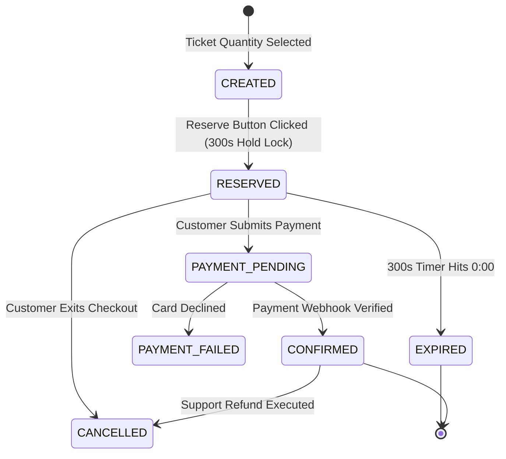

# EVENTRA — Booking State Machine Specification

---

## 1. Booking State Transition Diagram

---

## 2. Booking State Metadata Table

| State Name | Meaning & Entry Condition | Allowed Transitions | Inventory Effect | Payment Relationship | Ticket Relationship | Customer-Visible Meaning |
| :--- | :--- | :--- | :--- | :--- | :--- | :--- |
| **`CREATED`** | Customer selected quantity on event page. | `RESERVED` | Unlocked | None | None | "Selecting Tickets" |
| **`RESERVED`** | Inventory locked under 300s hold timer. | `PAYMENT_PENDING`, `EXPIRED`, `CANCELLED` | Locked (-Qty) | None | None | "Reserved (Timer Active)" |
| **`PAYMENT_PENDING`** | Payment submitted to gateway. | `CONFIRMED`, `PAYMENT_FAILED` | Locked (-Qty) | Pending Auth | None | "Processing Payment..." |
| **`CONFIRMED`** | Payment verified; booking finalized. | `CANCELLED` | Sold (-Qty) | Authorized | Tickets Issued | "Booking Confirmed" |
| **`PAYMENT_FAILED`** | Card declined by bank. | `PAYMENT_PENDING`, `EXPIRED` | Locked (-Qty) | Declined | None | "Payment Failed — Retry" |
| **`EXPIRED`** | 300s timer hit 0:00 without payment. | None (Terminal) | Restored (+Qty)| None | None | "Reservation Expired" |
| **`CANCELLED`** | Customer or support cancelled order. | None (Terminal) | Restored (+Qty)| Refunded | Invalidated | "Booking Cancelled" |

---

## 3. Definition of Done (DoD) — Booking State Machine
- [x] Booking state machine specified with state meanings, transitions, inventory effects, and payment/ticket relationships.
- [x] Saved to [`docs/requirements/booking-state-machine.md`](file:///Users/firozansari/Downloads/Coading/Intership/docs/requirements/booking-state-machine.md).
