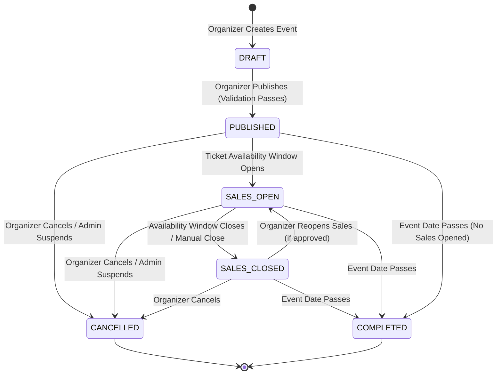

# EVENTRA — Event Management Requirements Specification

---

## 1. Overview & Purpose

This document defines the complete requirements for event creation, editing, publishing, cancellation, sales management, attendee management, staff management, pricing, ticket configuration, analytics, and event modification rules from the organizer's perspective. No technical implementation decisions are prescribed.

---

## 2. Event Creation

### 2.1 Event Creation Fields

| Field                             | Required / Optional / Conditional | Scope    | Notes                                                                            |
| :-------------------------------- | :-------------------------------- | :------- | :------------------------------------------------------------------------------- |
| **Event Title**                   | Required                          | MVP      | Max length: _OPEN BUSINESS DECISION_ (recommended 150 chars).                    |
| **Event Description**             | Required                          | MVP      | Rich text or plain text. Max length: _OPEN BUSINESS DECISION_.                   |
| **Event Date**                    | Required                          | MVP      | Must be a future date.                                                           |
| **Event Start Time**              | Required                          | MVP      | Combined with date for scheduling.                                               |
| **Event End Time**                | Required                          | MVP      | Must be after start time.                                                        |
| **Location / Address**            | Required                          | MVP      | Free-text address or venue reference.                                            |
| **Venue**                         | Conditional                       | MVP      | Required if reserved seating or named venue configuration is used.               |
| **Event Category**                | Required                          | MVP      | Must select from approved categories (e.g., Tech, Workshop, Meetup, Conference). |
| **Event Banner Image**            | Optional                          | MVP      | Supported formats: _OPEN BUSINESS DECISION_.                                     |
| **Additional Images/Media**       | Optional                          | Advanced | Gallery images. Approval and moderation rules: _OPEN BUSINESS DECISION_.         |
| **Organizer Display Information** | Required (auto-populated)         | MVP      | Organizer display name and optional description from organizer profile.          |
| **Ticket Categories**             | Required (at least one)           | MVP      | At least one ticket category must be configured before publication.              |
| **Event Policies**                | Optional                          | Advanced | Refund policy, age restrictions, accessibility info.                             |
| **Tags / Keywords**               | Optional                          | Advanced | For improved search discovery.                                                   |

### 2.2 Event Creation Requirements

| Requirement ID  | Requirement                                                                                                | Priority | Scope |
| :-------------- | :--------------------------------------------------------------------------------------------------------- | :------- | :---- |
| **EVT-CRE-001** | An authenticated organizer must be able to create a new event by providing required event information.     | Must     | MVP   |
| **EVT-CRE-002** | Upon creation, the event must default to `DRAFT` status and remain hidden from the public catalog.         | Must     | MVP   |
| **EVT-CRE-003** | The system must validate that the event date is in the future at the time of creation.                     | Must     | MVP   |
| **EVT-CRE-004** | The system must validate that the event end time is after the event start time.                            | Must     | MVP   |
| **EVT-CRE-005** | The organizer must be able to save a partially completed event as a draft and return to complete it later. | Must     | MVP   |
| **EVT-CRE-006** | The system must assign event ownership to the creating organizer. Consistent with BRULE-008.               | Must     | MVP   |
| **EVT-CRE-007** | The system must support uploading a single banner image at event creation.                                 | Should   | MVP   |

---

## 3. Event Editing

### 3.1 Editing Rules by Event Phase

| Event Phase                                           | Editable Fields                                                                             | Restricted Fields                                        | Notes                                             |
| :---------------------------------------------------- | :------------------------------------------------------------------------------------------ | :------------------------------------------------------- | :------------------------------------------------ |
| **Before Publishing (DRAFT)**                         | All fields freely editable.                                                                 | None.                                                    | Organizer has full editing freedom.               |
| **After Publishing, Before Sales**                    | Title, description, images, policies, tags, category, ticket categories (add new), pricing. | Venue change: _OPEN BUSINESS DECISION_.                  | Changes visible to public immediately.            |
| **After Sales Started (Reservations/Bookings Exist)** | Description, images, policies, tags.                                                        | See Section 17 — Modification Rules.                     | Capacity/pricing changes subject to restrictions. |
| **Near Event Start (< 24 hours before)**              | Description, images only.                                                                   | Date, time, venue, capacity, pricing, ticket categories. | _OPEN BUSINESS DECISION_ — exact cutoff window.   |
| **After Event Start**                                 | No material changes permitted.                                                              | All fields.                                              | Event is in progress or completed.                |

### 3.2 Editing Requirements

| Requirement ID  | Requirement                                                                                       | Priority | Scope |
| :-------------- | :------------------------------------------------------------------------------------------------ | :------- | :---- |
| **EVT-EDT-001** | An organizer must be able to freely edit all fields of a `DRAFT` event.                           | Must     | MVP   |
| **EVT-EDT-002** | An organizer must be able to edit permitted fields of a `PUBLISHED` event.                        | Must     | MVP   |
| **EVT-EDT-003** | The system must enforce field-level edit restrictions based on event phase and existing bookings. | Must     | MVP   |
| **EVT-EDT-004** | Changes to a published event must be immediately reflected in the public catalog.                 | Must     | MVP   |
| **EVT-EDT-005** | The system must display clear error messages when an edit is rejected due to restrictions.        | Must     | MVP   |

---

## 4. Event Lifecycle (Organizer-Facing)

### 4.1 Event States

| State            | Meaning                                                                                            | Organizer Permissions                                    | Customer Visibility                               | Ticket/Inventory Implications                                                   | Consistent With    |
| :--------------- | :------------------------------------------------------------------------------------------------- | :------------------------------------------------------- | :------------------------------------------------ | :------------------------------------------------------------------------------ | :----------------- |
| **DRAFT**        | Event created but not yet published.                                                               | Full editing. Cannot sell tickets.                       | Not visible in public catalog.                    | Inventory may be configured but not active.                                     | lifecycle-rules.md |
| **PUBLISHED**    | Event live in public catalog. Sales may or may not be open depending on ticket availability dates. | Restricted editing per rules. Can cancel.                | Visible in public catalog and search.             | Inventory active.                                                               | lifecycle-rules.md |
| **SALES_OPEN**   | Subset of PUBLISHED — at least one ticket category is within its availability window.              | Same as PUBLISHED. Can close sales manually.             | Tickets available for purchase.                   | Active holds and sales.                                                         | —                  |
| **SALES_CLOSED** | All ticket categories past their availability window, or manually closed by organizer.             | Can reopen sales (_OPEN BUSINESS DECISION_). Can cancel. | Event visible but tickets not purchasable.        | Inventory locked for new sales.                                                 | —                  |
| **CANCELLED**    | Event cancelled by organizer or suspended/cancelled by admin. Terminal state.                      | No editing permitted.                                    | Marked as cancelled. Removed from active catalog. | All active bookings flagged for cancellation/refund. Consistent with BRULE-010. | lifecycle-rules.md |
| **COMPLETED**    | Event date has passed. System-triggered. Terminal state.                                           | View-only. Analytics accessible.                         | Marked as past event.                             | No further sales or holds.                                                      | lifecycle-rules.md |

> **Note**: `SALES_OPEN` and `SALES_CLOSED` are sub-states of `PUBLISHED`. Whether these are distinct system states or derived from ticket availability dates is a _technical implementation decision deferred to later phases_.

### 4.2 Event State Transition Diagram

### 4.3 Forbidden Transitions

| Transition              | Reason                                                                                           |
| :---------------------- | :----------------------------------------------------------------------------------------------- |
| `PUBLISHED` → `DRAFT`   | Once published, an event cannot revert to draft. Organizer should cancel and create a new event. |
| `CANCELLED` → any state | Cancellation is terminal.                                                                        |
| `COMPLETED` → any state | Completion is terminal.                                                                          |
| `DRAFT` → `CANCELLED`   | Draft events that are not needed should be deleted, not cancelled (no bookings to reconcile).    |

---

## 5. Event Publishing

### 5.1 Publication Pre-Conditions (Validation Checklist)

| Validation Rule                                      | Required For Publication | Requirement ID |
| :--------------------------------------------------- | :----------------------- | :------------- |
| Event title is provided and non-empty.               | Yes                      | EVT-PUB-001    |
| Event description is provided and non-empty.         | Yes                      | EVT-PUB-001    |
| Event date is in the future.                         | Yes                      | EVT-PUB-002    |
| Event start time and end time are valid.             | Yes                      | EVT-PUB-002    |
| Location/venue is specified.                         | Yes                      | EVT-PUB-003    |
| At least one ticket category is configured.          | Yes                      | EVT-PUB-004    |
| Total inventory is greater than zero.                | Yes                      | EVT-PUB-005    |
| Ticket pricing is set (price ≥ 0 for each category). | Yes                      | EVT-PUB-006    |
| Event category is selected.                          | Yes                      | EVT-PUB-007    |
| Organizer account is `ACTIVE`.                       | Yes                      | EVT-PUB-008    |

### 5.2 Publication Requirements

| Requirement ID  | Requirement                                                                                                             | Priority | Scope    |
| :-------------- | :---------------------------------------------------------------------------------------------------------------------- | :------- | :------- |
| **EVT-PUB-001** | The system must validate all required event fields before allowing publication.                                         | Must     | MVP      |
| **EVT-PUB-002** | The system must reject publication if the event date is in the past.                                                    | Must     | MVP      |
| **EVT-PUB-003** | The system must reject publication if no location or venue is specified.                                                | Must     | MVP      |
| **EVT-PUB-004** | The system must reject publication if no ticket categories are configured.                                              | Must     | MVP      |
| **EVT-PUB-005** | The system must reject publication if total inventory is zero.                                                          | Must     | MVP      |
| **EVT-PUB-006** | The system must reject publication if any ticket category has an invalid price (negative value).                        | Must     | MVP      |
| **EVT-PUB-007** | The system must reject publication if no event category is selected.                                                    | Must     | MVP      |
| **EVT-PUB-008** | The system must reject publication if the organizer's account is `SUSPENDED`.                                           | Should   | Advanced |
| **EVT-PUB-009** | If validation fails, the system must return a complete list of all validation errors, not just the first error.         | Must     | MVP      |
| **EVT-PUB-010** | Upon successful publication, the event status transitions to `PUBLISHED` and becomes visible in the public catalog.     | Must     | MVP      |
| **EVT-PUB-011** | An organizer must not be able to publish an event that is already `PUBLISHED`, `CANCELLED`, or `COMPLETED`.             | Must     | MVP      |
| **EVT-PUB-012** | Unpublishing a published event (reverting to draft) is not supported. The organizer must cancel and create a new event. | Must     | MVP      |

---

## 6. Event Cancellation

### 6.1 Cancellation Requirements

| Requirement ID  | Requirement                                                                                                                                    | Priority                                                                          | Scope    |
| :-------------- | :--------------------------------------------------------------------------------------------------------------------------------------------- | :-------------------------------------------------------------------------------- | :------- |
| **EVT-CAN-001** | An organizer must be able to cancel a `PUBLISHED`, `SALES_OPEN`, or `SALES_CLOSED` event.                                                      | Must                                                                              | MVP      |
| **EVT-CAN-002** | Upon cancellation, the event status must transition to `CANCELLED` (terminal state).                                                           | Must                                                                              | MVP      |
| **EVT-CAN-003** | Upon cancellation, the event must be removed from the public catalog or clearly marked as "Cancelled".                                         | Must                                                                              | MVP      |
| **EVT-CAN-004** | All active reservations (holds) for the cancelled event must be released and inventory restored.                                               | Must                                                                              | MVP      |
| **EVT-CAN-005** | All confirmed bookings (`PAID`) for the cancelled event must be flagged for cancellation and refund reconciliation. Consistent with BRULE-010. | Should                                                                            | Advanced |
| **EVT-CAN-006** | Attendees with confirmed bookings must be notified of the cancellation.                                                                        | Should                                                                            | Advanced |
| **EVT-CAN-007** | Issued tickets for cancelled bookings must be invalidated.                                                                                     | Should                                                                            | Advanced |
| **EVT-CAN-008** | The organizer must not be able to cancel an already-cancelled or completed event.                                                              | Must                                                                              | MVP      |
| **EVT-CAN-009** | Cancellation requires explicit confirmation from the organizer (to prevent accidental cancellation).                                           | Must                                                                              | MVP      |
| **EVT-CAN-010** | Refund policy for organizer-initiated cancellation.                                                                                            | _OPEN BUSINESS DECISION_ — Whether full refund is automatic or subject to policy. | Advanced |

---

## 7. Ticket Configuration

### 7.1 Ticket Category Requirements

| Requirement ID  | Requirement                                                                                                                        | Priority | Scope    |
| :-------------- | :--------------------------------------------------------------------------------------------------------------------------------- | :------- | :------- |
| **TKT-CFG-001** | An organizer must be able to create one or more ticket categories for an event.                                                    | Must     | MVP      |
| **TKT-CFG-002** | Each ticket category must have: a name, a price, and a quantity (inventory allocation).                                            | Must     | MVP      |
| **TKT-CFG-003** | An organizer may optionally provide a description for each ticket category.                                                        | Should   | MVP      |
| **TKT-CFG-004** | An organizer must be able to set an availability period (start date/time and end date/time) for each ticket category.              | Should   | Advanced |
| **TKT-CFG-005** | Ticket categories may have an independent status: `ACTIVE`, `PAUSED`, `SOLD_OUT`.                                                  | Should   | Advanced |
| **TKT-CFG-006** | An organizer must be able to add new ticket categories to a published event (subject to venue capacity).                           | Should   | Advanced |
| **TKT-CFG-007** | An organizer must not be able to delete a ticket category that has existing confirmed bookings.                                    | Must     | MVP      |
| **TKT-CFG-008** | An organizer must be able to configure at least one of: General Admission (quantity-based) or Reserved Seating (seat-based).       | Must     | MVP      |
| **TKT-CFG-009** | For MVP, a single ticket category (General Admission) is sufficient. Multi-tier pricing is Advanced scope. Consistent with BR-003. | —        | —        |

### 7.2 Ticket Policies

| Requirement ID  | Requirement                                                                                                                        | Priority                 | Scope      |
| :-------------- | :--------------------------------------------------------------------------------------------------------------------------------- | :----------------------- | :--------- |
| **TKT-POL-001** | An organizer may optionally define a refund policy per event. The actual refund enforcement rules are an _OPEN BUSINESS DECISION_. | Should                   | Advanced   |
| **TKT-POL-002** | An organizer may optionally define a transfer/exchange policy per event.                                                           | _OPEN BUSINESS DECISION_ | Production |

---

## 8. Pricing

### 8.1 Pricing Requirements

| Requirement ID | Requirement                                                                                                            | Priority                                                                                                                                       | Scope      |
| :------------- | :--------------------------------------------------------------------------------------------------------------------- | :--------------------------------------------------------------------------------------------------------------------------------------------- | :--------- |
| **PRC-001**    | Each ticket category must have a base price set by the organizer.                                                      | Must                                                                                                                                           | MVP        |
| **PRC-002**    | Ticket price must be zero or a positive monetary value. Free events are permitted (price = $0.00).                     | Must                                                                                                                                           | MVP        |
| **PRC-003**    | Prices must be expressed in the platform's base currency (USD). Consistent with domain-rules.md.                       | Must                                                                                                                                           | MVP        |
| **PRC-004**    | Financial values must be rounded to 2 decimal places using standard half-up rounding. Consistent with domain-rules.md. | Must                                                                                                                                           | MVP        |
| **PRC-005**    | An organizer must be able to change ticket prices for a `DRAFT` event freely.                                          | Must                                                                                                                                           | MVP        |
| **PRC-006**    | An organizer must be able to change ticket prices for a `PUBLISHED` event before any bookings exist for that category. | Must                                                                                                                                           | MVP        |
| **PRC-007**    | Price changes after confirmed bookings exist for a ticket category require policy decisions.                           | _OPEN BUSINESS DECISION_ — Options: (a) apply only to future sales, (b) prevent price reduction, (c) allow with notification to future buyers. | Advanced   |
| **PRC-008**    | Discount or promotional pricing (coupon codes, percentage off).                                                        | _OPEN BUSINESS DECISION_ — Not required for MVP.                                                                                               | Advanced   |
| **PRC-009**    | Platform service fees per ticket.                                                                                      | _OPEN BUSINESS DECISION_ — Fee structure (flat vs percentage) deferred to Phase 5. Consistent with domain-rules.md.                            | Production |
| **PRC-010**    | Tax calculation and display.                                                                                           | _OPEN BUSINESS DECISION_ — Requires legal/tax review. Consistent with domain-rules.md.                                                         | Production |
| **PRC-011**    | Multi-currency support.                                                                                                | _OPEN BUSINESS DECISION_ — Deferred to Phase 5. Consistent with domain-rules.md.                                                               | Production |

---

## 9. Sales Management

### 9.1 Organizer-Visible Sales Information

| Requirement ID | Information Accessible to Organizer                               | Priority | Scope    |
| :------------- | :---------------------------------------------------------------- | :------- | :------- |
| **SALES-001**  | Total tickets sold per event (aggregate count).                   | Must     | MVP      |
| **SALES-002**  | Total tickets currently reserved (active holds) per event.        | Must     | MVP      |
| **SALES-003**  | Total tickets available (remaining inventory) per event.          | Must     | MVP      |
| **SALES-004**  | Number of cancelled bookings per event.                           | Should   | Advanced |
| **SALES-005**  | Number of refunded bookings per event.                            | Should   | Advanced |
| **SALES-006**  | Attendance count (checked-in attendees) per event.                | Should   | Advanced |
| **SALES-007**  | Sales breakdown by ticket category (sold/available per category). | Must     | MVP      |
| **SALES-008**  | Sales timeline (daily/weekly booking counts over time).           | Should   | Advanced |
| **SALES-009**  | Total revenue per event (sum of confirmed payment amounts).       | Should   | Advanced |

---

## 10. Attendee Management

### 10.1 Attendee Information Access

| Requirement ID | Requirement                                                                                                                                                     | Priority                                                                         | Scope      |
| :------------- | :-------------------------------------------------------------------------------------------------------------------------------------------------------------- | :------------------------------------------------------------------------------- | :--------- |
| **ATT-001**    | An organizer must be able to view a list of attendees (customers with confirmed bookings) for their own events only.                                            | Must                                                                             | MVP        |
| **ATT-002**    | The attendee list must display: attendee name, attendee email, ticket category, booking status, attendance status (checked-in or not).                          | Must                                                                             | MVP        |
| **ATT-003**    | An organizer must be able to search attendees by name or email within an event.                                                                                 | Should                                                                           | Advanced   |
| **ATT-004**    | An organizer must be able to filter attendees by ticket category, booking status, or attendance status.                                                         | Should                                                                           | Advanced   |
| **ATT-005**    | An organizer must not access attendee payment details, account passwords, or booking history for other events. Consistent with ORG-SEC-020 through ORG-SEC-022. | Must                                                                             | MVP        |
| **ATT-006**    | Attendee list export (CSV/PDF).                                                                                                                                 | _OPEN BUSINESS DECISION_ — Requires privacy review. Consistent with ORG-SEC-023. | Production |

---

## 11. Event Staff Management

### 11.1 Staff Assignment Requirements

| Requirement ID | Requirement                                                                                                                                                                | Priority | Scope      |
| :------------- | :------------------------------------------------------------------------------------------------------------------------------------------------------------------------- | :------- | :--------- |
| **STAFF-001**  | An organizer must be able to assign registered users as event staff for events they own.                                                                                   | Must     | MVP        |
| **STAFF-002**  | An organizer must be able to remove assigned staff from their events.                                                                                                      | Must     | MVP        |
| **STAFF-003**  | Assigned staff must receive the `GATE_STAFF` role scoped to the specific event(s) they are assigned to.                                                                    | Must     | MVP        |
| **STAFF-004**  | Event staff must only be able to verify tickets (QR scanning) for events they are assigned to. Consistent with domain-rules.md (Staff Assignment, Verification Authority). | Must     | MVP        |
| **STAFF-005**  | An organizer must not assign staff to events they do not own. Consistent with BRULE-008.                                                                                   | Must     | MVP        |
| **STAFF-006**  | An organizer must be able to view the list of staff assigned to each event.                                                                                                | Must     | MVP        |
| **STAFF-007**  | Staff must not gain organizer-level privileges (event editing, sales access, attendee management) unless explicitly granted.                                               | Must     | MVP        |
| **STAFF-008**  | An organizer must not automatically gain unrestricted platform-admin (`SUPER_ADMIN`) privileges.                                                                           | Must     | MVP        |
| **STAFF-009**  | Staff assignment/removal must be auditable.                                                                                                                                | Should   | Production |

---

## 12. Organizer Analytics

### 12.1 Analytics Requirements

| Requirement ID | Analytics Capability                                                                                                         | Priority | Scope      |
| :------------- | :--------------------------------------------------------------------------------------------------------------------------- | :------- | :--------- |
| **ANLY-001**   | **MVP**: Total tickets sold, available, and reserved per event. (Duplicates SALES-001 through SALES-003 for dashboard view.) | Must     | MVP        |
| **ANLY-002**   | **MVP**: Total confirmed bookings count per event.                                                                           | Must     | MVP        |
| **ANLY-003**   | **Advanced**: Sales breakdown by ticket category.                                                                            | Should   | Advanced   |
| **ANLY-004**   | **Advanced**: Sales timeline (bookings over time — daily/weekly).                                                            | Should   | Advanced   |
| **ANLY-005**   | **Advanced**: Attendance rate (checked-in / total sold).                                                                     | Should   | Advanced   |
| **ANLY-006**   | **Advanced**: Revenue summary per event.                                                                                     | Should   | Advanced   |
| **ANLY-007**   | **Advanced**: Cancellation/refund rate per event.                                                                            | Should   | Advanced   |
| **ANLY-008**   | **Production**: Real-time sales dashboard with live updates.                                                                 | Could    | Production |
| **ANLY-009**   | **Production**: Exportable reports (CSV/PDF).                                                                                | Could    | Production |
| **ANLY-010**   | **Production**: Cross-event analytics (aggregate metrics across all organizer events).                                       | Could    | Production |

> **Note**: Analytics technology (data warehouse, BI tools, charting libraries) is a technical implementation decision deferred to later phases.

---

## 13. Event Modification Rules

### 13.1 Modification Restrictions Matrix

| Field                          | Before Sales (DRAFT/PUBLISHED, No Bookings) | After Reservations Exist            | After Confirmed Bookings                         | Near Event Start (< 24h) |
| :----------------------------- | :------------------------------------------ | :---------------------------------- | :----------------------------------------------- | :----------------------- |
| **Event Title**                | ✅ Freely editable                          | ✅ Editable                         | ✅ Editable (with caution)                       | ❌ Restricted            |
| **Event Description**          | ✅ Freely editable                          | ✅ Editable                         | ✅ Editable                                      | ✅ Editable              |
| **Event Date**                 | ✅ Freely editable                          | ⚠️ _OPEN BUSINESS DECISION_         | ⚠️ _Dangerous — requires policy_                 | ❌ Restricted            |
| **Event Time**                 | ✅ Freely editable                          | ⚠️ _OPEN BUSINESS DECISION_         | ⚠️ _Dangerous — requires policy_                 | ❌ Restricted            |
| **Venue**                      | ✅ Freely editable                          | ⚠️ _OPEN BUSINESS DECISION_         | ⚠️ _Dangerous — seat assignments invalidated_    | ❌ Restricted            |
| **Capacity (Increase)**        | ✅ Freely editable                          | ✅ Allowed                          | ✅ Allowed                                       | ❌ Restricted            |
| **Capacity (Decrease)**        | ✅ Freely editable                          | ⚠️ Must not go below reserved count | ❌ Must not go below sold + reserved. BRULE-009. | ❌ Restricted            |
| **Seat Configuration**         | ✅ Freely editable                          | ⚠️ Cannot remove held seats         | ❌ Cannot remove booked seats                    | ❌ Restricted            |
| **Ticket Quantity (Increase)** | ✅ Freely editable                          | ✅ Allowed (within capacity)        | ✅ Allowed (within capacity)                     | ❌ Restricted            |
| **Ticket Quantity (Decrease)** | ✅ Freely editable                          | ⚠️ Must not go below reserved       | ❌ Must not go below sold + reserved             | ❌ Restricted            |
| **Ticket Price**               | ✅ Freely editable                          | ✅ Applies to future sales          | ⚠️ _OPEN BUSINESS DECISION_ (PRC-007)            | ❌ Restricted            |
| **Ticket Categories (Add)**    | ✅ Freely editable                          | ✅ Allowed                          | ✅ Allowed                                       | ❌ Restricted            |
| **Ticket Categories (Remove)** | ✅ Freely editable                          | ⚠️ Only if no holds for category    | ❌ Not if confirmed bookings exist (TKT-CFG-007) | ❌ Restricted            |
| **Images/Media**               | ✅ Freely editable                          | ✅ Editable                         | ✅ Editable                                      | ✅ Editable              |
| **Policies/Tags**              | ✅ Freely editable                          | ✅ Editable                         | ✅ Editable                                      | ✅ Editable              |

### 13.2 Dangerous Changes Requiring Policy Decisions

| Change                              | Risk                                                                            | Required Policy Decision                                          |
| :---------------------------------- | :------------------------------------------------------------------------------ | :---------------------------------------------------------------- |
| **Date/time change after bookings** | Attendees may have travel/schedule commitments.                                 | Notification to affected attendees? Automatic refund eligibility? |
| **Venue change after bookings**     | Reserved seat assignments invalidated; attendees may have location-based plans. | Automatic refund? Seat re-assignment? Notification?               |
| **Capacity decrease below sold**    | Violates confirmed booking obligations.                                         | Forbidden by BRULE-009.                                           |
| **Price reduction after sales**     | Early buyers may feel disadvantaged.                                            | Retroactive price adjustment? Notification only?                  |
| **Price increase after sales**      | Applies only to future sales.                                                   | Clear communication to new buyers.                                |

---

## 14. Definition of Done — Event Management Requirements

- [x] Event creation fields and requirements defined.
- [x] Event editing rules defined by event phase.
- [x] Event lifecycle states, transitions, and forbidden transitions defined with Mermaid diagram.
- [x] Event publishing pre-conditions and requirements defined.
- [x] Event cancellation behaviour defined.
- [x] Ticket configuration requirements defined.
- [x] Pricing requirements defined.
- [x] Sales management (organizer-visible information) defined.
- [x] Attendee management requirements defined.
- [x] Event staff management requirements defined.
- [x] Organizer analytics requirements defined.
- [x] Event modification restriction matrix defined.
- [x] Dangerous changes and open policy decisions identified.
- [x] No technical implementation prematurely selected.
- [x] Saved to [`docs/requirements/event-management-requirements.md`](docs/requirements/event-management-requirements.md).
