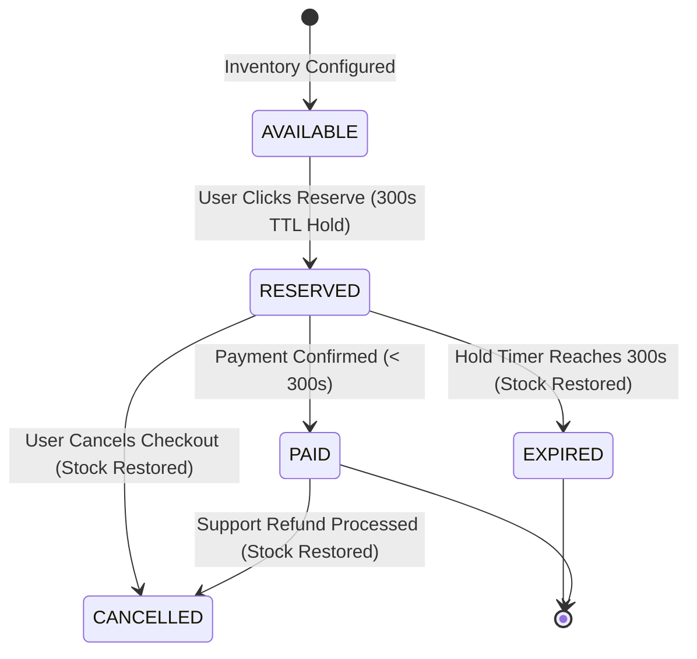
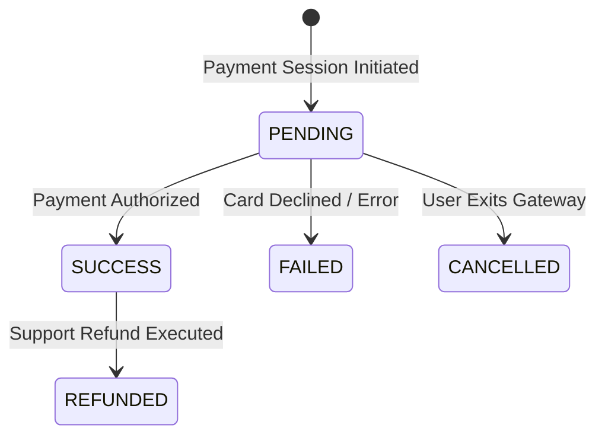
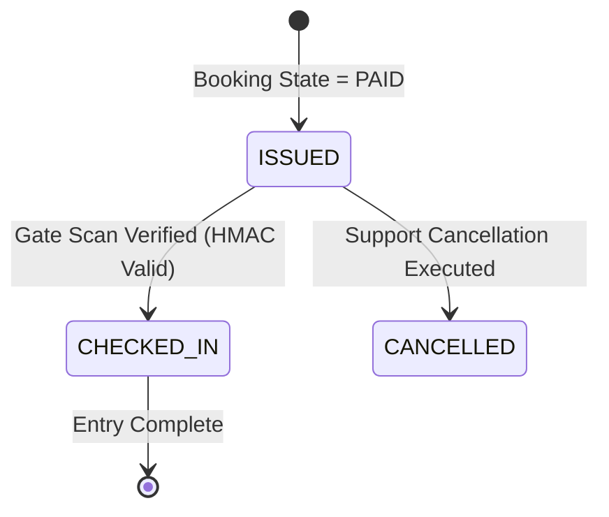

# EVENTRA — Functional State Machine & Failure Behavior Specification

---

## 1. Domain State Machine Specifications

---

### A. Booking State Machine

---

### B. Payment State Machine

---

### C. Ticket Pass State Machine

---

## 2. Failure & Edge Case Behavior Matrix

| Failure Scenario | Trigger Condition | System Functional State Behavior | Customer / UI Response |
| :--- | :--- | :--- | :--- |
| **1. Stock Exhaustion During Click** | Remaining stock reaches 0 milliseconds before reservation transaction. | System aborts reservation transaction. Zero stock change. | Returns HTTP 409 Conflict: "Tickets no longer available." |
| **2. Reservation Hold Expiration** | 300-second TTL timer reaches 0 without payment verification. | Booking state transitions `RESERVED` $\rightarrow$ `EXPIRED`. Stock restored to public catalog. | Displays "Reservation Expired" alert and redirects to catalog view. |
| **3. Payment Card Declined** | Bank rejects transaction payload. | Booking remains `RESERVED` within remaining timer window. Payment state = `FAILED`. | Displays "Payment Declined. Please try another card" error; timer continues ticking. |
| **4. Payment Cancelled by User** | User closes payment modal or clicks "Cancel". | Booking state transitions `RESERVED` $\rightarrow$ `CANCELLED`. Stock count immediately restored. | Redirects user back to event page with hold release message. |
| **5. Client Disconnects After Payment Success** | Browser crashes immediately after payment succeeds. | Backend webhook transitions booking `RESERVED` $\rightarrow$ `PAID`, issues tickets, and sends email. | User receives confirmation email with ticket link; order viewable in account portal upon reconnect. |
| **6. Duplicate Payment Webhook** | Gateway sends identical payment webhook twice. | System checks transaction idempotency key $\rightarrow$ ignores duplicate payload. | Zero duplicate tickets generated; returns HTTP 200 to gateway. |
| **7. Payment Received After Expired** | Delayed gateway callback arrives for `EXPIRED` booking. | System marks order `PAYMENT_MISMATCH_REFUND_PENDING` and triggers auto-refund. | User receives email notification: "Payment received after reservation expired. Automatic refund issued." |
| **8. User Refreshes Checkout Page** | User reloads browser during active hold timer. | System queries existing active reservation by token and renders current remaining timer. | Checkout page reloads cleanly with running countdown timer intact. |
| **9. Multiple Tab Checkout Attempts** | User opens 3 browser tabs attempting multiple reservations. | System detects existing active hold reservation for user $\rightarrow$ prompts user to complete or cancel active hold. | Displays notice: "You already have an active reservation. Please complete your existing order." |

---

## 3. Definition of Done (DoD) — State Behavior
- [x] State machines specified for Booking, Payment, and Ticket entities.
- [x] All 9 critical failure and edge case state behaviors documented.
- [x] Saved to [`docs/requirements/functional-state-behaviour.md`](file:///Users/firozansari/Downloads/Coading/Intership/docs/requirements/functional-state-behaviour.md).
