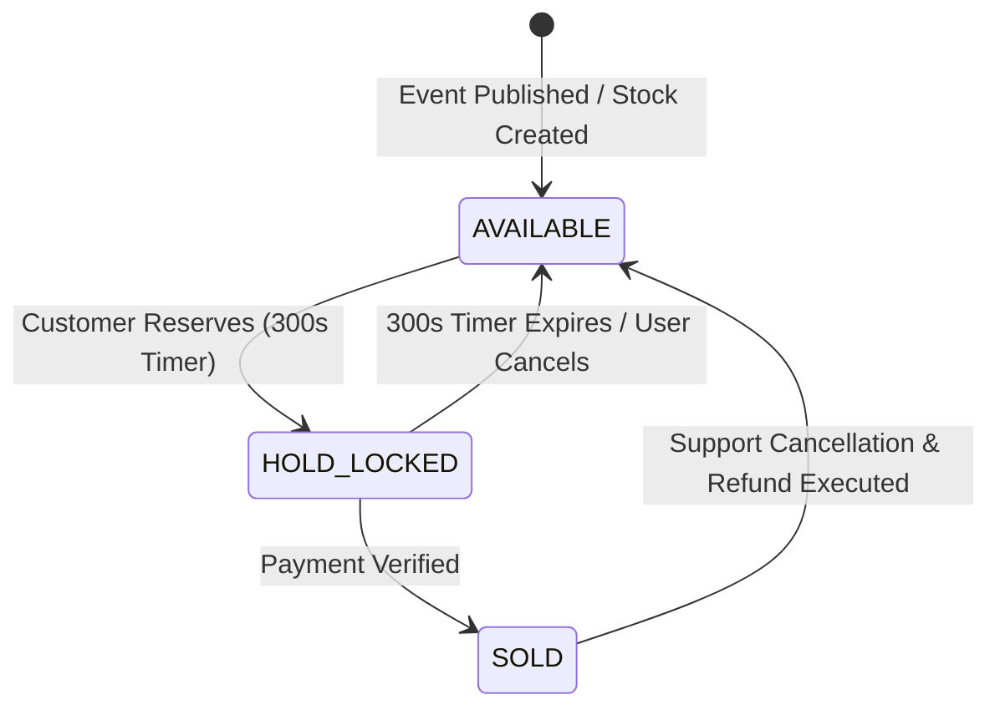

# EVENTRA — Inventory & Seat State Machine Specifications

---

## 1. Inventory Unit State Transition Diagram

---

## 2. Seat State Model (Reserved Seating Tier)

| Seat State | Meaning | Trigger | Effect on Availability |
| :--- | :--- | :--- | :--- |
| **`AVAILABLE`** | Seat is unreserved and open for selection. | Event publication or hold expiry. | Included in public selection. |
| **`HELD`** | Seat is locked by a customer for 300 seconds. | Customer selects specific seat. | Excluded from public selection. |
| **`BOOKED`** | Seat is permanently assigned to paid order. | Payment verification webhook. | Permanently removed from stock. |
| **`RELEASED`** | Seat restored due to cancellation. | Support refund or order cancellation. | Restored to `AVAILABLE` state. |

---

## 3. Definition of Done (DoD) — Inventory State Machine
- [x] Inventory unit and seat state models defined with transition triggers and availability effects.
- [x] Saved to [`docs/requirements/inventory-state-machine.md`](file:///Users/firozansari/Downloads/Coading/Intership/docs/requirements/inventory-state-machine.md).
