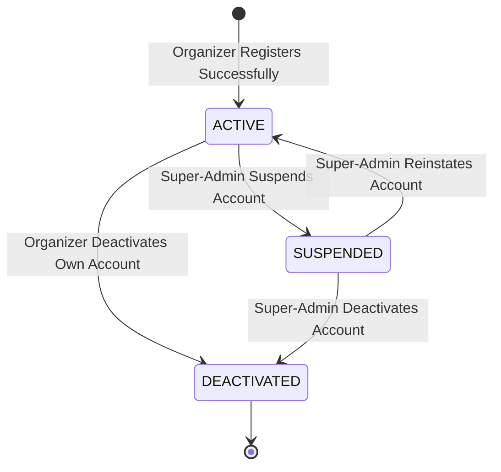
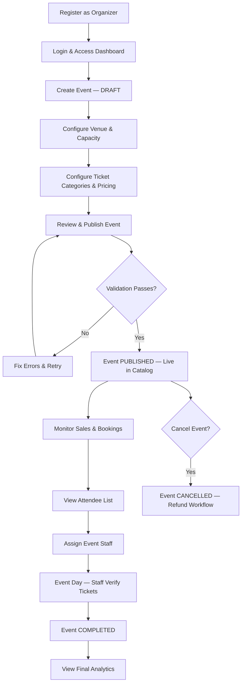
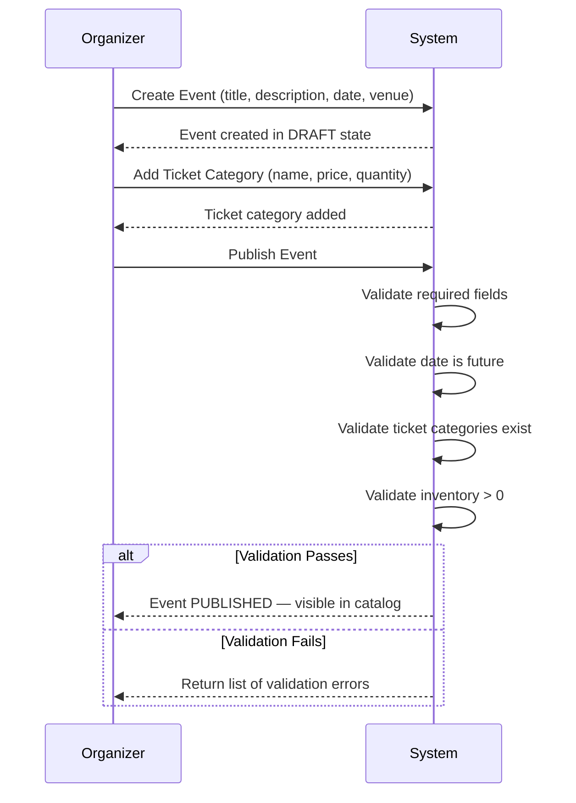
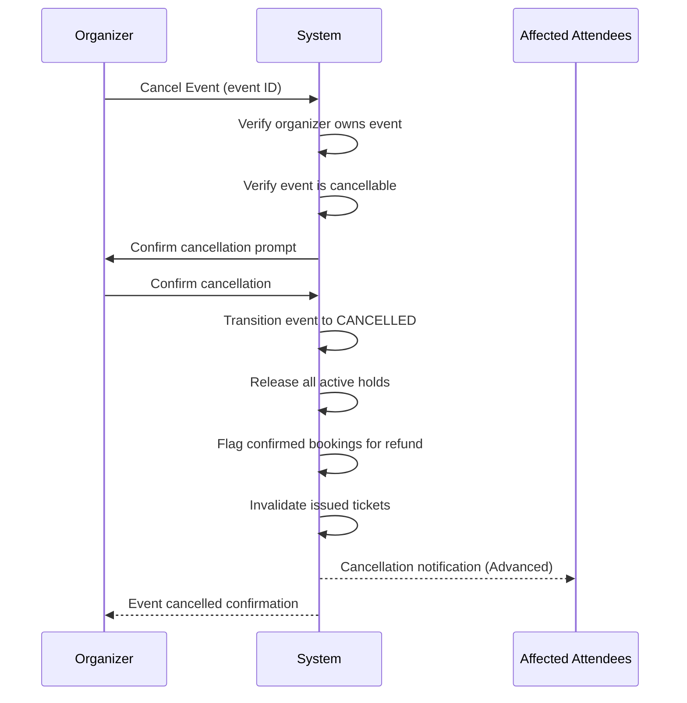

# EVENTRA — Organizer Lifecycle Specification

---

## 1. Overview & Purpose

This document defines the complete organizer lifecycle and the organizer's end-to-end workflow within EVENTRA. It covers the organizer account lifecycle, the organizer event workflow, and the operational sequences an organizer follows from onboarding through event completion. No technical implementation decisions are prescribed.

---

## 2. Organizer Account Lifecycle

### 2.1 Account State Diagram

### 2.2 Account State Definitions

| State           | Meaning                                                                                      | Organizer Capabilities                                                                                                          | Event Impact                                                                                                                                  |
| :-------------- | :------------------------------------------------------------------------------------------- | :------------------------------------------------------------------------------------------------------------------------------ | :-------------------------------------------------------------------------------------------------------------------------------------------- |
| **ACTIVE**      | Fully operational organizer account.                                                         | Create events, edit events, publish events, manage staff, view analytics.                                                       | Events can be created, published, and managed normally.                                                                                       |
| **SUSPENDED**   | Account suspended by platform admin due to policy violation or investigation.                | Cannot create new events. Cannot publish draft events. Existing published events: _OPEN BUSINESS DECISION_ (hidden or flagged). | Existing bookings remain valid unless events are also suspended.                                                                              |
| **DEACTIVATED** | Account voluntarily deactivated by organizer or permanently closed by admin. Terminal state. | No actions permitted.                                                                                                           | Existing events: _OPEN BUSINESS DECISION_ — options: (a) cancel all with refunds, (b) transfer to platform, (c) keep active until completion. |

### 2.3 Account Lifecycle Requirements

| Requirement ID    | Requirement                                                                              | Priority | Scope    |
| :---------------- | :--------------------------------------------------------------------------------------- | :------- | :------- |
| **LIFE-ACCT-001** | New organizer accounts default to `ACTIVE` upon successful registration.                 | Must     | MVP      |
| **LIFE-ACCT-002** | A super-admin can transition an organizer account from `ACTIVE` to `SUSPENDED`.          | Should   | Advanced |
| **LIFE-ACCT-003** | A super-admin can reinstate a `SUSPENDED` account back to `ACTIVE`.                      | Should   | Advanced |
| **LIFE-ACCT-004** | An organizer can voluntarily deactivate their own account (transition to `DEACTIVATED`). | Should   | Advanced |
| **LIFE-ACCT-005** | `DEACTIVATED` is a terminal state — the account cannot be reactivated.                   | Should   | Advanced |
| **LIFE-ACCT-006** | Account suspension must trigger a notification to the organizer (ORG-NOTIF-004).         | Must     | MVP      |

---

## 3. Organizer Event Workflow

### 3.1 End-to-End Organizer Workflow (MVP)

The MVP organizer workflow enables a coherent journey from onboarding to event completion:

### 3.2 Workflow Stage Descriptions

| Stage                    | Description                                                                      | Key Requirements                                  |
| :----------------------- | :------------------------------------------------------------------------------- | :------------------------------------------------ |
| **1. Register**          | Organizer creates account with name, email, password.                            | ORG-REG-001 through ORG-REG-004                   |
| **2. Login & Dashboard** | Organizer logs in and is directed to organizer dashboard.                        | ORG-DASH-001, FR-002                              |
| **3. Create Event**      | Organizer fills in event details; event saved as `DRAFT`.                        | EVT-CRE-001 through EVT-CRE-006                   |
| **4. Configure Venue**   | Organizer specifies venue name, address, capacity type (GA or reserved seating). | VEN-001, VEN-GA-001                               |
| **5. Configure Tickets** | Organizer creates ticket categories with name, price, quantity.                  | TKT-CFG-001 through TKT-CFG-003, PRC-001, PRC-002 |
| **6. Publish**           | Organizer publishes event after all validations pass.                            | EVT-PUB-001 through EVT-PUB-010                   |
| **7. Monitor Sales**     | Organizer views tickets sold, reserved, available on dashboard.                  | SALES-001 through SALES-003, SALES-007            |
| **8. View Attendees**    | Organizer views attendee list with booking and attendance status.                | ATT-001, ATT-002                                  |
| **9. Assign Staff**      | Organizer assigns gate staff for ticket verification.                            | STAFF-001 through STAFF-004                       |
| **10. Event Day**        | Staff verify tickets via QR scanning at venue entrance.                          | BRULE-006, FR-016                                 |
| **11. Completion**       | System transitions event to `COMPLETED` after event date passes.                 | lifecycle-rules.md                                |
| **12. Analytics**        | Organizer reviews final sales, attendance, and performance metrics.              | ANLY-001, ANLY-002                                |

---

## 4. Event Lifecycle (Organizer Perspective)

This section consolidates the event lifecycle from the organizer's operational view. See `event-management-requirements.md` Section 4 for the authoritative state diagram and transition rules.

### 4.1 Organizer Actions by Event State

| Event State      | Organizer Can                                                                          | Organizer Cannot                                                     |
| :--------------- | :------------------------------------------------------------------------------------- | :------------------------------------------------------------------- |
| **DRAFT**        | Edit all fields, configure venue/tickets/inventory, publish, delete draft.             | Sell tickets, view sales, assign staff (no event to scan for).       |
| **PUBLISHED**    | Edit permitted fields, cancel, assign staff, view dashboard.                           | Revert to DRAFT.                                                     |
| **SALES_OPEN**   | View sales metrics, manage attendees, adjust inventory (within rules), cancel.         | Edit restricted fields (date/venue/capacity per modification rules). |
| **SALES_CLOSED** | View sales metrics, manage attendees, reopen sales (_OPEN BUSINESS DECISION_), cancel. | Create new bookings, edit restricted fields.                         |
| **CANCELLED**    | View historical data only.                                                             | Edit, publish, reopen.                                               |
| **COMPLETED**    | View analytics, view attendees, export data (if approved).                             | Edit, cancel, reopen sales.                                          |

---

## 5. Organizer Workflow Failure Paths

| Workflow Stage       | Failure Path              | Resolution                                               |
| :------------------- | :------------------------ | :------------------------------------------------------- |
| Registration         | Duplicate email           | Error message: "Email already registered."               |
| Registration         | Weak password             | Validation error with requirements.                      |
| Event Creation       | Past date entered         | Validation error: "Event date must be in the future."    |
| Publication          | Missing fields            | Full validation error list returned.                     |
| Publication          | Zero inventory            | Error: "Event must have available inventory to publish." |
| Publication          | Account suspended         | Authorization error.                                     |
| Inventory Adjustment | Decrease below sold count | Rejection with current counts.                           |
| Staff Assignment     | Event not owned           | 403 Forbidden.                                           |
| Cancellation         | Already cancelled         | Error: "Event is already cancelled."                     |

---

## 6. Organizer Operational Sequences

### 6.1 Sequence: Event Creation to Publication

### 6.2 Sequence: Event Cancellation

---

## 7. Open Business Decisions

| Decision ID      | Decision Area              | Description                                                                                                                  |
| :--------------- | :------------------------- | :--------------------------------------------------------------------------------------------------------------------------- |
| **OBD-LIFE-001** | Suspended Account Events   | Whether published events are hidden or flagged when the organizer account is suspended.                                      |
| **OBD-LIFE-002** | Deactivated Account Events | What happens to existing events when an organizer deactivates their account (cancel with refunds, transfer, or keep active). |
| **OBD-LIFE-003** | Sales Reopen               | Whether an organizer can reopen sales after manually closing them.                                                           |
| **OBD-LIFE-004** | Draft Deletion             | Whether draft events are permanently deleted or soft-deleted.                                                                |

---

## 8. Definition of Done — Organizer Lifecycle

- [x] Organizer account lifecycle states and transitions defined with Mermaid diagram.
- [x] End-to-end organizer workflow defined with flowchart.
- [x] Organizer actions by event state defined.
- [x] Workflow failure paths documented.
- [x] Key operational sequences defined with sequence diagrams.
- [x] Open business decisions catalogued.
- [x] No technical implementation prematurely selected.
- [x] Saved to [`docs/requirements/organizer-lifecycle.md`](docs/requirements/organizer-lifecycle.md).
