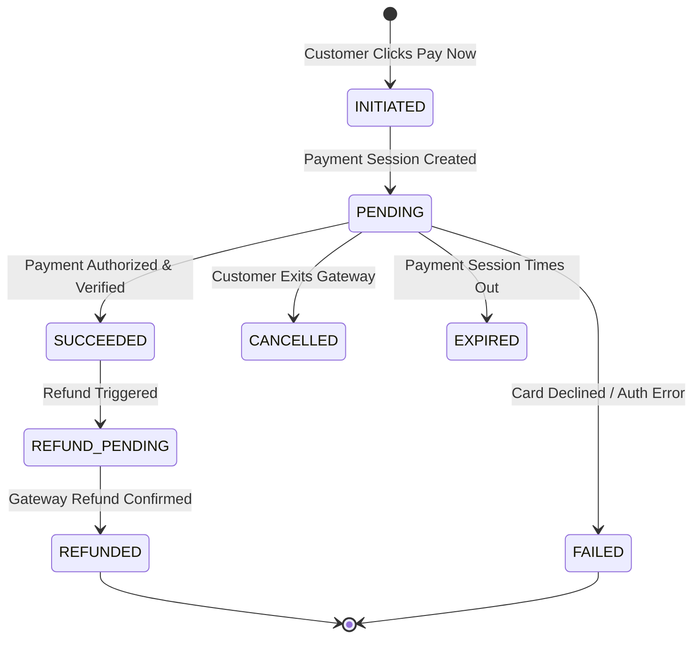

# EVENTRA — Payment State Machine Specification

---

## 1. Payment State Transition Diagram

---

## 2. Payment State Transition Metadata Table

| Payment State | System Meaning | Customer-Visible Status | Allowed Transitions | Booking Impact | Inventory Impact |
| :--- | :--- | :--- | :--- | :--- | :--- |
| **`INITIATED`** | Checkout initiated. | "Preparing Payment..." | `PENDING`, `CANCELLED` | `RESERVED` | Locked (-Qty) |
| **`PENDING`** | Awaiting gateway response/webhook. | "Processing Payment..." | `SUCCEEDED`, `FAILED`, `CANCELLED`, `EXPIRED` | `RESERVED` | Locked (-Qty) |
| **`SUCCEEDED`** | Payment verified by gateway. | "Payment Successful" | `REFUND_PENDING` | Transitions to `PAID` | Sold (-Qty) |
| **`FAILED`** | Card declined or bank error. | "Payment Declined" | `PENDING` (Retry) | Remains `RESERVED` (Timer ticks) | Locked (-Qty) |
| **`CANCELLED`** | Customer closed payment view. | "Payment Cancelled" | `PENDING` | Transitions to `CANCELLED` | Restored (+Qty) |
| **`REFUNDED`** | Refund authorized and executed. | "Refund Completed" | None (Terminal) | Transitions to `CANCELLED` | Restored (+Qty) |

---

## 3. Definition of Done (DoD) — Payment State Machine
- [x] Payment state machine specified with allowed/forbidden transitions, customer-visible statuses, and booking/inventory impacts.
- [x] Saved to [`docs/requirements/payment-state-machine.md`](file:///Users/firozansari/Downloads/Coading/Intership/docs/requirements/payment-state-machine.md).
