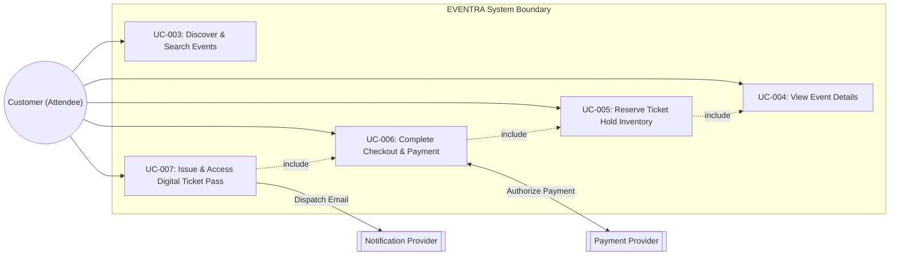
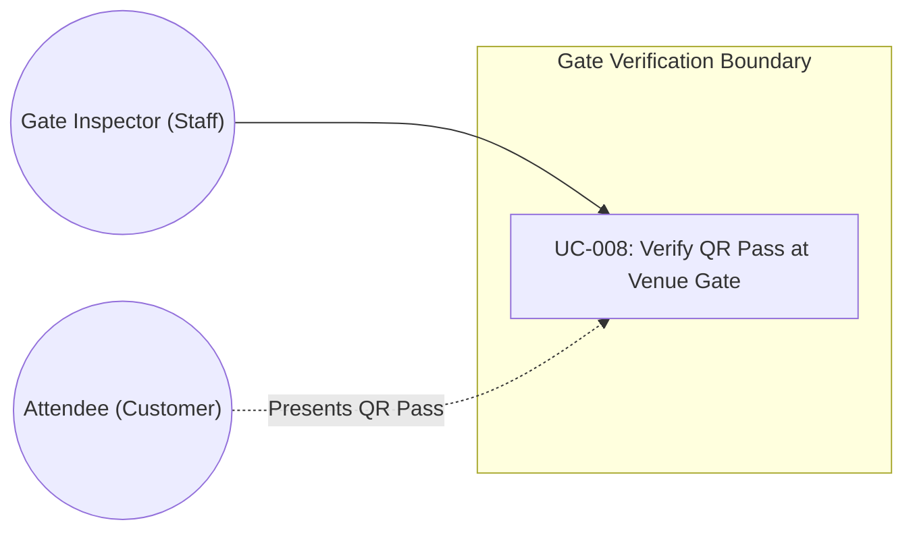
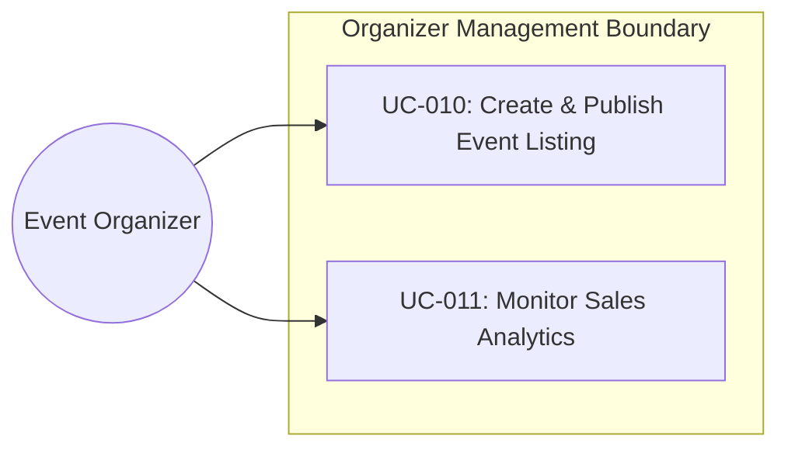

# EVENTRA — Use Case Diagrams & Interaction Models

---

## 1. Customer Ticket Booking Use Case Diagram

---

## 2. Gate Staff QR Verification Use Case Diagram

---

## 3. Organizer Event Lifecycle Use Case Diagram

---

## 4. Definition of Done (DoD) — Use Case Diagrams
- [x] Mermaid diagrams created for Customer Booking, Gate Verification, and Organizer Event Lifecycle.
- [x] Saved to [`docs/requirements/use-case-diagrams.md`](file:///Users/firozansari/Downloads/Coading/Intership/docs/requirements/use-case-diagrams.md).
